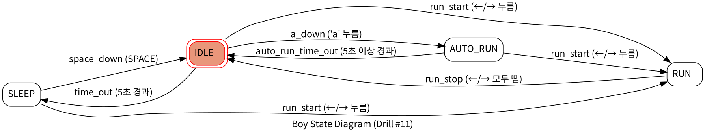

# PRD: Drill #11 소년 자동 무적 런(AutoRun) 상태 추가

## 1. 개요

LEC12 캐릭터 컨트롤러(IDLE, SLEEP, RUN 상태)에 **자동 무적 런(AutoRun)** 상태를 추가한다.
IDLE 상태에서 `a` 키를 누르면 소년이 키 조작 없이 화면 좌우를 자동으로 오가며 달린다.
AutoRun 중에는 더 빠르고 더 크게 보이며, 5초가 지나거나 방향키를 누르면 AutoRun이 끝난다.

## 2. 개발 환경

| 항목 | 내용 |
|---|---|
| 언어 | Python 3.13 |
| 그래픽 라이브러리 | pico2d |
| 상태 머신 라이브러리 | transitions 0.9.3 (`pip install transitions`) |
| 캔버스 | 800 × 600 (`open_canvas()` 기본 크기) |
| 스프라이트 | `animation_sheet.png` (프레임 100 × 100, 가로 8프레임) |
| 배경 | `grass.png` |

## 3. 파일 구성

| 파일 | 역할 |
|---|---|
| `main.py` | 게임 루프 (handle_events → update_world → render_world) |
| `boy.py` | 소년 클래스와 상태 클래스(Idle, Sleep, Run, AutoRun), 상태 머신 |
| `glass.py` | 잔디(Grass) 클래스 |
| `animation_sheet.png`, `grass.png` | 실행에 필요한 이미지 |
| `state_diagram.png` | 상태 다이어그램 |
| `PRD.md` | 이 문서 |

## 4. 기존 기능 (LEC12에서 구현한 것, 유지)

- IDLE: 제자리 대기 애니메이션. 5초 동안 입력이 없으면 SLEEP.
- SLEEP: 누워서 자는 모습. SPACE를 누르면 IDLE, 방향키를 누르면 RUN.
- RUN: 방향키를 누르는 동안 그 방향으로 달림. 방향키를 모두 떼면 IDLE.
- 왼쪽/오른쪽은 별도 상태가 아니라 하나의 RUN 상태에서 `dir` 값으로 구분.
- 화면 밖으로 나가지 않음.
- 애니메이션 프레임은 시간 기준(0.05초에 한 장)으로 넘김.

## 5. 추가 기능 요구사항 (AutoRun)

| 번호 | 요구사항 |
|---|---|
| FR-1 | IDLE 상태에서 `a` 키를 누르면 AUTO_RUN 상태가 된다. |
| FR-2 | AUTO_RUN에서는 키 조작 없이 계속 좌우로 이동한다. 처음에는 바라보던 방향으로 출발한다. |
| FR-3 | AUTO_RUN에서는 RUN보다 이동 속도가 빠르다. |
| FR-4 | AUTO_RUN에서는 소년의 크기가 확대된다. 발 위치(바닥선)는 그대로 유지한다. |
| FR-5 | 화면 좌우 끝에 닿으면 자동으로 방향을 바꾼다. 확대된 이미지가 화면 밖으로 나가지 않는다. |
| FR-6 | AUTO_RUN 상태로 5초 이상 지나면 IDLE 상태로 돌아간다. |
| FR-7 | AUTO_RUN 중 방향키를 누르면 AutoRun이 취소되고, 눌린 방향으로 움직이는 RUN 상태가 된다. |
| FR-8 | AutoRun은 반드시 별도의 상태 클래스(`AutoRun`)로 구현한다. |
| FR-9 | 상태 다이어그램을 이미지 파일로 저장소에 포함한다. |

## 6. 상태 설계

각 상태는 transitions의 `State`를 상속한 `BoyState` 클래스를 부모로 하는 **상태 클래스**로 만든다.

| 메서드 | 호출 시점 |
|---|---|
| `on_enter_state(boy)` | 상태에 들어갈 때 (Entry action) |
| `on_exit_state(boy)` | 상태에서 나갈 때 (Exit action) |
| `do(boy)` | 상태에 머무는 동안 매 프레임 (Do activity) |
| `draw(boy)` | 그리기 |

### 6.1 상태 목록

| 상태 | 클래스 | 하는 일 |
|---|---|---|
| IDLE | `Idle` | 대기 애니메이션, 5초 타이머 |
| SLEEP | `Sleep` | 누워서 자는 모습 |
| RUN | `Run` | 방향키 방향으로 이동 |
| AUTO_RUN | `AutoRun` | 자동 좌우 이동, 빠른 속도, 2배 크기, 5초 타이머 |

### 6.2 상태 전환

| 출발 | 이벤트 (trigger) | 도착 |
|---|---|---|
| IDLE | `time_out` (IDLE로 5초 경과) | SLEEP |
| SLEEP | `space_down` (SPACE) | IDLE |
| IDLE, SLEEP | `run_start` (←/→ 누름) | RUN |
| RUN | `run_stop` (←/→ 모두 뗌) | IDLE |
| IDLE | `a_down` (`a` 누름) | AUTO_RUN |
| AUTO_RUN | `auto_run_time_out` (AUTO_RUN으로 5초 경과) | IDLE |
| AUTO_RUN | `run_start` (←/→ 누름) | RUN |

그 상태에 정의되지 않은 이벤트는 무시한다(`ignore_invalid_triggers=True`). 예: SLEEP에서 `a`, RUN에서 `a`.

### 6.3 상태 다이어그램

## 7. 수치

| 항목 | 값 |
|---|---|
| RUN 이동 속도 | 갱신 1회당 5 px |
| AUTO_RUN 이동 속도 | 갱신 1회당 15 px (RUN의 3배) |
| 프레임 간격 | RUN·IDLE 0.05초, AUTO_RUN 0.025초 (다리도 2배 빠르게) |
| AUTO_RUN 크기 | 2배 (100 × 100 → 200 × 200) |
| AUTO_RUN 그리기 y | y + 50 (발 위치 유지) |
| AUTO_RUN 이동 범위 | x 100 ~ 700 (확대된 폭 200의 절반만큼 여백) |
| RUN 이동 범위 | x 50 ~ 750 |
| SLEEP 대기 시간 | IDLE로 5초 |
| AUTO_RUN 유지 시간 | 5초 |

## 8. 개발 단계

작은 단위로 구현하고 실행 확인 후 커밋한다.

1. PRD.md 작성
2. 이동 속도·대기 시간 상수 정리
3. 상태 클래스 구조 도입 (BoyState, Idle, Sleep, Run) — 동작은 기존과 같게 유지
4. AutoRun 상태 클래스 추가, IDLE에서 `a`로 진입
5. AutoRun 자동 이동
6. 화면 좌우 끝에서 자동 방향 전환
7. AutoRun 속도 증가
8. AutoRun 크기 확대
9. AutoRun 5초 경과 시 IDLE 복귀
10. AutoRun 중 방향키로 RUN 전환
11. 상태 다이어그램 이미지 추가
12. 검증 결과 정리

## 9. 검증 계획

| 확인 항목 | 기대 결과 |
|---|---|
| IDLE에서 `a` | AUTO_RUN, 키 없이 이동 시작 |
| AUTO_RUN 이동 속도 | 갱신 1회당 15 px (RUN 5 px보다 빠름) |
| AUTO_RUN 크기 | 200 × 200으로 그려지고 발 위치는 그대로 |
| 오른쪽 끝 / 왼쪽 끝 | x 700 / 100에서 방향 전환, 화면 밖으로 안 나감 |
| AUTO_RUN 5초 경과 | IDLE로 복귀, IDLE 5초 타이머 다시 시작 |
| AUTO_RUN 중 ← 또는 → | RUN, 눌린 방향으로 이동 |
| SLEEP에서 `a` | 무시 (SLEEP 유지) |
| 기존 기능 | IDLE ↔ SLEEP ↔ RUN 전환이 그대로 동작 |

## 10. 검증 결과

pico2d 창 대신 시간(`get_time`)과 그리기 함수를 대체한 테스트로 최종 `boy.py`를 확인했다.

| 확인 항목 | 결과 |
|---|---|
| IDLE에서 `a` → AUTO_RUN, 키 없이 이동 | 통과 |
| AUTO_RUN 이동량 갱신 1회당 15 px (RUN 5 px) | 통과 |
| AUTO_RUN 그리기 크기 200 × 200, y 140 (발 위치 유지) | 통과 |
| 오른쪽 끝 x 700 / 왼쪽 끝 x 100에서 방향 전환, 범위 밖 없음 | 통과 |
| AUTO_RUN 다리 애니메이션: 초당 약 33회 (IDLE 약 18회) | 통과 |
| 5초 전 AUTO_RUN 유지, 5초 경과 시 IDLE 복귀 및 IDLE 타이머 재시작 | 통과 |
| AUTO_RUN 중 ← / → → RUN, 눌린 방향으로 이동 | 통과 |
| SLEEP에서 `a` 무시 | 통과 |
| 기존 IDLE ↔ SLEEP ↔ RUN 전환 | 통과 |

각 개발 단계의 커밋도 같은 방식으로 단계별 동작을 확인한 뒤 올렸다.
